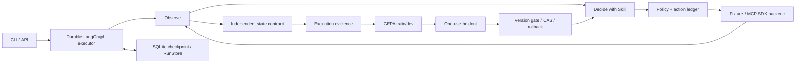

# PocketAgent Evolve

**Verified outcomes · durable execution · evidence-gated skill evolution**

PocketAgent Evolve is a local-first Android-tool agent and evaluation runtime. Version 0.3 moves the project toward verifiable execution: one LangGraph executor is shared by deployment and skill trials, declarative state contracts determine success, and a durable action ledger prevents blind replay of uncertain writes.

中文升级说明、研究依据与实现边界：[升级报告](docs/UPGRADE_REPORT_0.3.md) · [工程与面试说明](docs/ENGINEERING.md)

## Implemented

| Capability | Implementation | Boundary |
|---|---|---|
| Outcome verification | Versioned JSON-state postconditions and invariants | Requires a trustworthy observation and task-specific contract |
| Recovery | LangGraph SQLite checkpoints, job/device leases, stable execution identity | Resume requires the original runtime, actor, task, skill and tool schema |
| Uncertain actions | Intent/result ledger, reuse confirmed results | No claim of exactly-once external GUI actions |
| MCP | Official Python SDK 2.3, modern/legacy integration tests | Device server remains external |
| Skill search | GEPA 0.1.4 with shared executor, train/dev and one-use frozen holdout | No bundled Android or model-learning performance claims |
| Version lifecycle | Immutable content, transactional active pointer, baseline CAS, rollback | Automatic promotion limited to repeated local-fixture validation |
| Device evaluation | Explicit MCP reset actions and reset contracts | Operator must enable repeated device actions |
| Task API | Authenticated background task, status, resume and approval endpoints | Restart recovery is explicit, not a distributed job service |

The local settings fixture and scripted `demo` are integration checks. They are **not MobileGym, AndroidWorld, real Android, or evidence of LLM learning**. Full recursive self-improvement and foundation-model training are outside this release.

## Install and verify

Python **3.11+**; development verification uses Python 3.12.

```bash
uv sync --frozen --extra evolve --extra test
uv run --frozen --extra evolve python -m pocket_agent demo
uv run --frozen --extra evolve --extra test python -m unittest discover -s tests -v
```

Or activate a virtual environment and run `pip install -e ".[evolve,test]"`. The scripted demo needs no API key or phone and uses temporary state.

## Run a real model

Copy `.env.example` to `.env`; configure `LLM_MODEL`, `LLM_API_KEY` and your OpenAI-compatible endpoint. No weights or credentials are bundled.

```bash
python -m pocket_agent run examples/settings_task.json --run-id settings-001
python -m pocket_agent resume examples/settings_task.json settings-001
```

The example uses `backend: fixture`. For Android set `backend: mcp`, configure `MCP_SERVER_URL`, and adapt the task contract to your server's actual structured state. Tools are discovered but permissions remain local. The actor sees the objective and public observation, not the hidden outcome contract.

```json
{
  "backend": "fixture",
  "task": {
    "objective": "Enable Wi-Fi",
    "allowed_tools": ["android_get_ui_tree", "android_tap"],
    "contract": {
      "postconditions": [
        {"path": "/elements", "op": "contains", "value": {"id": "wifi", "value": true}}
      ]
    }
  },
  "initial_state": {"elements": [{"id": "wifi", "text": "Wi-Fi", "value": false}]}
}
```

A screenshot or a tool name alone never proves completion. Unknown delivery stops automatic dispatch; resume re-observes before deciding whether the outcome is already satisfied.

## GEPA skill evolution

```bash
python -m pocket_agent import-skill examples/settings_skill.md --activate
python -m pocket_agent optimize --skill settings-toggle \
  --suite examples/settings_suite.json --max-metric-calls 40 --max-actor-calls 500
python -m pocket_agent approve CANDIDATE_ID
python -m pocket_agent rollback settings-toggle 0.1.0
```

Only the final dev winner reaches the frozen holdout. Its suite hash is consumed once. A new search after seeing test outcomes requires fresh held-out tasks. `--auto-promote` pre-authorizes only repeated local-fixture validation with at least two held-out tasks; real-device automatic promotion is disabled. No dev improvement is a valid outcome—the example baseline may already solve every fixture.

For MCP evaluation, use `environment: mcp_device` in the suite, explicit reset contracts/actions and `--allow-device-eval`. This can change device state; use a resettable test environment. Do not turn a scripted or deliberately weakened baseline into a performance claim.

## Authenticated API

Set model configuration and a non-empty `POCKET_ADMIN_TOKEN` in the process environment:

```bash
uvicorn pocket_agent.api:create_app --factory --host 127.0.0.1 --port 8000
```

Every route below requires `Authorization: Bearer <POCKET_ADMIN_TOKEN>`. Only `/health` is public.

| Method | Route | Purpose |
|---|---|---|
| POST | `/v3/tasks` | Persist and schedule a contracted task |
| GET | `/v3/tasks/{run_id}` | Read durable run state and action ledger |
| POST | `/v3/tasks/{run_id}/resume` | Resume with the same request and execution identity |
| POST | `/v3/approvals/{approval_id}` | Decide a run-scoped approval |

HTTP disconnect does not cancel execution. After process restart explicitly resume; a crashed worker's lease must expire before another worker can claim its device. Runtime state defaults to `.runtime/pocket`.

## Architecture and research



- [GEPA](https://github.com/gepa-ai/gepa): actual library integration via a custom execution adapter.
- [Skill-V](https://arxiv.org/abs/2610.11781v1): inspiration for verifiable contracts; this project does not reproduce its full trained RL system.
- [SkillEvolBench](https://arxiv.org/abs/2605.24117v1): acquisition/deployment separation and raw-trajectory baselines.
- [MCP](https://github.com/modelcontextprotocol/python-sdk) / [LangGraph](https://github.com/langchain-ai/langgraph): protocol compatibility and persistent execution.
- [MobileGym](https://github.com/Purewhiter/mobilegym), [MobileWorld](https://github.com/Tongyi-MAI/MobileWorld), [AnTrap](https://github.com/gguogan/AnTrap): external validation targets, not bundled environments or claimed benchmark results.

## Legacy and license

The original `main.py`, `app.py` and `agent/` Python integration remain for compatibility. The supported 0.3 entry points are `python -m pocket_agent` and `pocket_agent.api`. Legacy tasks without contracts are now unverified. Historical 3D assets, external Skill packs and private generated skills are excluded from the clean release; the 3D frontend is not a release feature.

MIT for repository code; model, dataset and dependency licenses remain separate. See [third-party notices](THIRD_PARTY_NOTICES.md) and [security boundaries](SECURITY.md). Databases, logs, keys, private memory and machine-specific research reports are excluded from publication.
